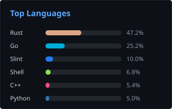

# hi there, I'm vugsk

*people or hero or god?*

---

### About me

I write native Linux apps and CLI tools in Rust, Go and C++, poke at ESP32/STM32 boards, and keep my Arch + niri setup tidy.
Hero or god? Mostly a person with a compiler.

- **Name:** GermanF0x: German by name, fox by nature, zero in the middle for the 1337 factor.
- **Gender:** Sarmat. Heavy, reliable, and best kept away from the launch button.
- **Location:** Union of Soviet Socialist Republics. It dissolved before I showed up, but nobody told my `$HOME`.

По-русски

- **Имя:** GermanF0x. Герман по паспорту, лис по духу, а нолик посередине для солидности.
- **Пол:** Сармат. Тяжёлый, надёжный и держится подальше от красной кнопки.
- **Откуда:** Союз Советских Социалистических Республик. Он распался до моего появления, но моему `$HOME` забыли об этом сообщить.

### Stack

---

